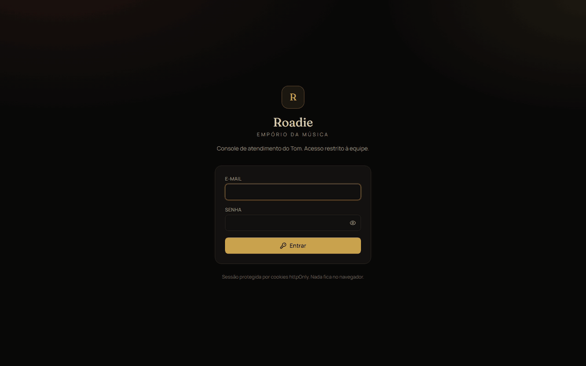
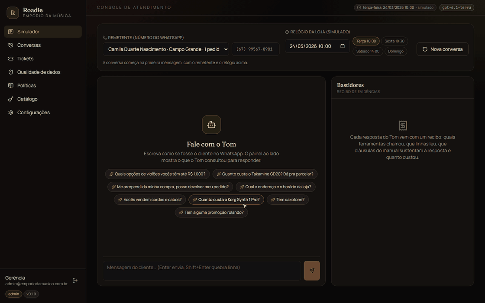
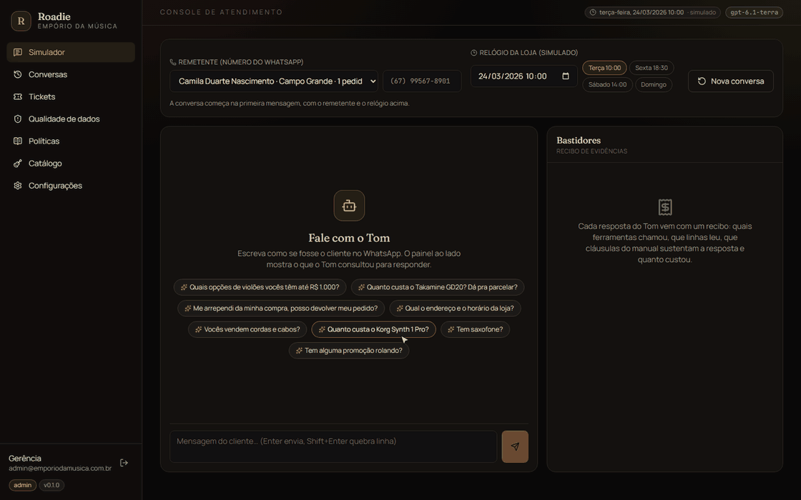
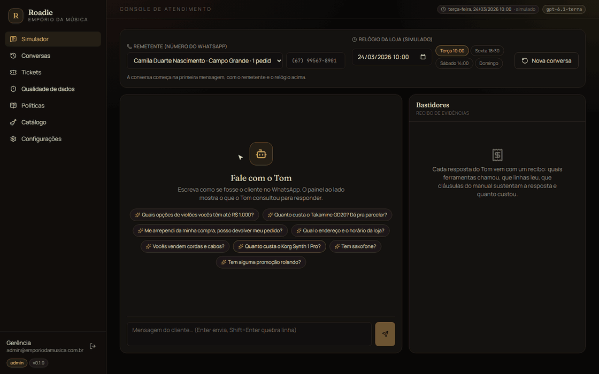
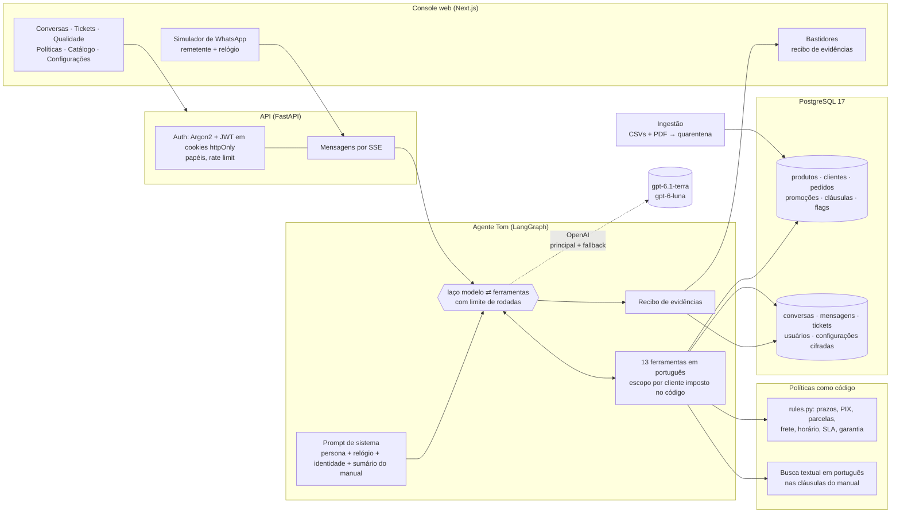

# 🎸 Roadie

> **Agente de atendimento da Empório da Música** que trata o manual da loja como código, entrega um recibo de evidências em cada resposta e só fala de pedidos com quem provou ser o dono deles. Persona: **Tom**, o atendente virtual que entende de música.

<p align="center">
  
  
  
  
  
  
  
  
  
  
</p>

Projeto desenvolvido para o desafio técnico de AI Engineer da [Artefact](https://www.artefact.com/). O enunciado está em [`docs/desafio/`](docs/desafio/).

### 🌐 No ar

**[roadie.lbai.dev](https://roadie.lbai.dev)**

> O acesso ao console é restrito. Para uma conta de demonstração, fale comigo pelo [LinkedIn](https://www.linkedin.com/in/leonardo-barretti/) ou por e-mail.

---

## 🎬 Em ação

Gravações do console com o modelo real, sem cortes nas respostas do Tom.

### 1. Devolução que vira cancelamento

<p align="center">
  
</p>

> Login no console e, no simulador, a Camila (identificada pelo telefone) pergunta se pode devolver a compra. Os *Bastidores* mostram as ferramentas em tempo real: o Tom consulta os pedidos dela, busca as cláusulas de troca e roda a regra de devolução, que descobre que o pedido 16 ainda nem foi enviado. O caminho é cancelamento, não devolução. Ela confirma e o Tom abre o ticket. O recibo fecha com identidade, fontes, cláusulas, regras determinísticas, tokens e custo.

### 2. Número desconhecido: verificação antes de falar do pedido

<p align="center">
  
</p>

> O remetente vem de um número não cadastrado e pergunta pelo pedido 8. O Tom não revela nada antes de confirmar a identidade pelo e-mail; depois informa o atraso e o rastreio e, a pedido da cliente, registra uma reclamação com protocolo e prazo de retorno calculado pelo relógio da loja.

### 3. Catálogo, produto ausente e assunto fora do escopo

<p align="center">
  
</p>

> Preço de tabela, PIX e parcelamento do Takamine GD20 vindos das regras de preço; saxofone que não existe no catálogo vira registro de interesse, não invenção; previsão do tempo é recusada com educação, sem chamar ferramenta.

### 4. Operação: conversas, tickets, qualidade de dados, políticas, catálogo e configurações

<p align="center">
  
</p>

> O histórico de conversas com o recibo de cada resposta, a fila de tickets que o Tom abriu, o que a ingestão encontrou de errado nos CSVs (em três severidades), o manual extraído do PDF em cláusulas com a mesma busca que o Tom usa, o catálogo com as sinalizações de quarentena e a configuração do modelo.

---

## 🎯 O desafio

A Empório da Música é uma loja fictícia de instrumentos em Campo Grande/MS. A equipe está afogada em perguntas repetidas no WhatsApp: horário, status de pedido, preço, estoque, troca. A missão era prototipar um agente de mensagens que assumisse a persona da loja, respondesse com base nos dados e no manual de políticas, soubesse quando consultar cada um, e lidasse bem com o que foge do escopo.

A loja forneceu seis CSVs (produtos, categorias, clientes, pedidos, itens e promoções) e um manual de políticas em PDF. Os dois têm armadilhas de propósito: produtos cuja descrição contradiz o nome, preços implausíveis, totais que não fecham, clientes quase homônimos, dois números de WhatsApp diferentes no mesmo manual. Tratar isso é parte do problema.

## 💡 A abordagem

A maior parte dos agentes de atendimento é um prompt grande, um RAG e fé. O Roadie parte de outra premissa: **o modelo de linguagem conversa; quem decide é o código.**

1. **Política como código, não só como texto.** Cada regra numérica do manual (7 dias de arrependimento, 30 de defeito, 5% no PIX que não acumula, parcela mínima por faixa, frete grátis acima de R$ 500, 24 horas úteis de retorno) virou uma função determinística com teste, que devolve o veredito e o **número da cláusula** que o sustenta. O Tom nunca faz conta nem data de cabeça. O texto do manual continua indexado, para ele explicar a regra em palavras de gente. Um teste de deriva confere que cada parâmetro do código ainda está, literalmente, na cláusula certa do PDF.
2. **Recibo de evidências em toda resposta.** Cada mensagem do Tom carrega quais ferramentas chamou e com que argumentos, quais tabelas e linhas leu, quais cláusulas citou, quais regras rodaram, que modelo respondeu, quantos tokens custou e quanto demorou. O console mostra isso ao vivo num painel de *Bastidores*. O avaliador vê que não houve alucinação; a equipe consegue auditar um atendimento.
3. **Identidade por construção.** Como no WhatsApp o remetente chega com o número, as ferramentas de pedido só enxergam os pedidos do cliente identificado. Número desconhecido? O Tom pede número do pedido e e-mail, com três tentativas, sem nunca revelar o que há no cadastro. O escopo é imposto no código das ferramentas, então uma injeção de prompt não tem como vazar o pedido de outra pessoa.
4. **Quarentena de dados.** A ingestão não corrige nem apaga os cadastros contraditórios: ela marca cada problema com uma severidade. Sobre um produto em quarentena, o Tom diz que há divergência no cadastro e abre um ticket para a equipe confirmar, em vez de afirmar um preço errado. O manual proíbe informação incorreta de preço e estoque; o sistema obedece.
5. **Relógio da loja.** O "agora" do agente é simulado e configurável, por ambiente e por conversa. É o que torna os prazos reproduzíveis com dados de 2025 e 2026 e permite testar "fora do expediente" com um clique.
6. **Passagem para humanos com protocolo.** Reclamações, cancelamentos, exceções e cadastros divergentes viram tickets com protocolo e prazo de 24 horas úteis, como manda o manual.
7. **Conversas douradas.** Um comando roda cenários roteirizados contra o agente real e grava as transcrições com os bastidores, conferindo ferramentas chamadas, cláusulas citadas e trechos esperados. As conversas de exemplo deste repositório saem daí.

## 🧭 Exemplos de interação

As transcrições estão em [`examples/`](examples/), geradas pelo comando `roadie evals` com o modelo real. Cada resposta do Tom traz o bloco *Bastidores* com o recibo de evidências e o resultado das verificações.

| # | Cenário | O que exercita |
|---|---|---|
| 1 | [Catálogo: violões até R$ 1.000 e produto esgotado](examples/01-catalogo-violoes.md) | Busca por faixa de preço e tipo de corda; produto ativo com estoque zero vira alternativa, não promessa |
| 2 | [Preço, parcelamento e promoção sem acumular com PIX](examples/02-preco-parcelas-promocao.md) | Regras de pagamento: parcela mínima por faixa, promoção com preço original e percentual, PIX que não soma |
| 3 | [Arrependimento em pedido ainda não enviado](examples/03-devolucao-pedido-pendente.md) | **Não trivial:** cliente identificada pelo telefone, consulta de pedidos em tempo real, política de trocas aplicada, ticket aberto |
| 4 | [Pedido atrasado com verificação de identidade](examples/04-pedido-atrasado-verificacao.md) | **Não trivial:** número desconhecido, verificação por pedido e e-mail, entrega além da previsão, rastreio e ticket de frete |
| 5 | [Domingo: horário, acessórios, assunto alheio, categoria vazia e quarentena](examples/05-fora-de-escopo-e-quarentena.md) | Loja fechada, recusa de acessórios e de assunto fora da música, categoria sem produtos, cadastro em quarentena |

## 🏗️ Arquitetura



### Como uma mensagem vira resposta

1. O console abre a conversa com o **número do remetente** e o **relógio** escolhidos. Se o número está no cadastro, a cliente já entra identificada.
2. A API persiste a mensagem e monta o contexto: relógio, identidade, sumário das cláusulas.
3. O grafo chama o modelo com o prompt da persona. O modelo decide quais ferramentas usar (catálogo, pedidos, políticas, cálculos, ticket) e as chama, em até seis rodadas.
4. Cada ferramenta devolve dois valores: o conteúdo que o modelo lê e um **artefato de evidência** que não vai para o modelo, mas vai para o recibo.
5. A resposta final é persistida com o recibo; o console recebe tudo por SSE, token a token, com as consultas aparecendo conforme acontecem.

### As ferramentas do Tom

| Ferramenta | O que faz | Fontes |
|---|---|---|
| `buscar_produtos` | Catálogo por termo, categoria, faixa de preço, cordas, eletrônica; tolera frases inteiras e erros de digitação | `products`, `promotions` |
| `detalhar_produto` | Preço de tabela, PIX, promoção, parcelamento máximo, alternativas quando indisponível ou em quarentena | `products`, regras de preço e parcelas |
| `promocoes_ativas` | Só promoções com `is_active`; nunca promete promoção expirada | `promotions` |
| `verificar_identidade` | Pedido + e-mail ou telefone; três tentativas; nada do cadastro é revelado | `orders`, `customers` |
| `meus_pedidos` / `consultar_pedido` | Pedidos do cliente identificado, com situação de entrega e atraso | `orders`, `order_items` |
| `avaliar_devolucao` | Arrependimento, defeito ou preferência com os prazos do manual e a data de recebimento | regra `return_eligibility` |
| `calcular_parcelas` / `calcular_frete` / `horario_loja` | Regras determinísticas com cláusula citada | `rules.py` |
| `informacoes_loja` | Endereço, contatos, história, escopo | cláusulas 0, 1, 1.2, 7 |
| `consultar_politicas` | Busca textual nas cláusulas, com peso no título, prefixos para variações de palavra e seções expandidas | `policy_clauses` |
| `abrir_ticket` | Protocolo `RD-AAAA-NNNN` e prazo de 24 horas úteis | `tickets`, regra `complaint_sla` |

## 🛠️ Decisões técnicas

Resumo das escolhas que o enunciado pede para justificar. O detalhe, com alternativas descartadas, está em [`docs/decisoes.md`](docs/decisoes.md); premissas e ambiguidades, em [`docs/premissas.md`](docs/premissas.md).

| Decisão | Escolha | Por quê |
|---|---|---|
| Abordagem do agente | **Híbrida**: function calling orquestrado por LangGraph, com ferramentas tipadas sobre SQL parametrizado, regras determinísticas e busca textual no manual | O modelo decide *o que* consultar; o código decide *o que é verdade*. Sem SQL gerado por modelo, sem contas feitas por modelo |
| Framework | LangGraph 1.x com um grafo pequeno e explícito | Limite de rodadas, prompt de sistema montado por rodada e estado observável, sem a opacidade de agentes pré-prontos |
| Modelo e provedor | OpenAI, `gpt-6.1-terra` como principal e `gpt-6-luna` como fallback automático; modelo simulado para testes | Boa relação qualidade e custo em function calling; fallback transparente em falha ou cota; os 67 testes rodam sem rede e sem custo |
| Retrieval | Full-text search do PostgreSQL em português, sem acentos, sobre 29 cláusulas numeradas extraídas do PDF, com casamento por prefixo para verbo e substantivo ("devolver" acha "devolução") | Para um manual de 8 páginas, busca lexical com stemming acerta, custa zero e cabe no mesmo banco. `pgvector` entra sem trocar de arquitetura se o acervo crescer |
| Estratégia de prompt | Persona com regras numeradas do manual, contexto por rodada (relógio, identidade, sumário do manual) e ferramentas que devolvem `instrucao` quando algo falta | O prompt diz como se comportar; as ferramentas dizem o que é verdade; a resposta nunca cita número de cláusula ao cliente, o recibo registra |
| Persistência | PostgreSQL para tudo: dados da loja, conversas, mensagens com recibo, tickets, usuários, configurações cifradas | Um único sistema para operar e auditar; histórico de conversa reconstruído a cada mensagem |
| Tratamento dos dados | Ingestão com validação por linha, extração do PDF pela numeração do próprio manual e quarentena com três severidades | Marcar em vez de corrigir preserva a verdade dos dados e dá à loja a lista do que consertar |
| Interface | CLI para avaliação rápida e console web com login para a equipe | O enunciado aceita CLI; o console existe porque um agente que auxilia a equipe precisa ser visto pela equipe |
| Relógio | Simulado e configurável, padrão 24/03/2026 10:00 | Os dados terminam em março de 2026; sem isso, nenhuma devolução seria demonstrável |

## 🔐 Segurança

O projeto nasceu para ir a um servidor, então segurança não ficou para depois.

- **Senhas com Argon2id**, nunca em texto; política mínima de força.
- **Sessão em cookies httpOnly e SameSite**: token de acesso JWT de 15 minutos e sessão de refresh de 7 dias com **rotação a cada uso** e revogação no logout. O JavaScript do navegador nunca vê o token.
- **Login com tempo constante**: e-mail inexistente e senha errada levam o mesmo tempo e dão a mesma resposta.
- **Papéis**: administrador gerencia usuários e o modelo; atendente usa o console. Ninguém se remove nem se rebaixa.
- **Rate limit** no login e no envio de mensagens; **CORS** por allowlist; cabeçalhos de segurança; docs da API desligadas em produção; a aplicação se recusa a subir em produção com o segredo padrão.
- **Chave da OpenAI cifrada** no banco com chave derivada de `SECRET_KEY`; nunca devolvida pela API, só os quatro últimos caracteres.
- **Privacidade por construção**: ferramentas de pedido com escopo por cliente, e-mails e telefones nunca repetidos ao cliente, instruções embutidas na mensagem do cliente ignoradas por desenho.
- **Produção atrás do Caddy**: um domínio, HTTPS automático, banco e API fora do host.

## 🚀 Como rodar

### Pré-requisitos

- Docker e Docker Compose
- Uma chave da OpenAI (pode ser cadastrada depois, pelo console)

### Em dois comandos

```bash
cp .env.example .env
```

Edite o `.env`: `SECRET_KEY` (gere um valor longo), `POSTGRES_PASSWORD`, `ADMIN_EMAIL` e `ADMIN_PASSWORD` do primeiro administrador, e `OPENAI_API_KEY` se já tiver em mãos. Depois:

```bash
docker compose up --build
```

O contêiner da API espera o banco, cria o schema, carrega os CSVs e o manual com a quarentena, cria o administrador e sobe. Em seguida:

- Console: http://localhost:3000 (entre com `ADMIN_EMAIL` e `ADMIN_PASSWORD`)
- API: http://localhost:8000/health e http://localhost:8000/docs
- Sem chave no `.env`? Vá em **Configurações**, cole a chave, clique em **Testar conexão** e **Salvar**. O Tom passa a responder na hora.

As portas são configuráveis no `.env` (`WEB_PORT`, `API_PORT`, `POSTGRES_PORT`).

### No simulador

Escolha o remetente (um dos 50 clientes ou um número não cadastrado), ajuste o relógio da loja se quiser e converse como se fosse o cliente. O painel *Bastidores* mostra, em tempo real, o que o Tom consultou para responder.

### Pela linha de comando

```bash
docker compose exec api roadie chat --phone "(67) 99567-8901"
```

```bash
docker compose exec api roadie ask "Quanto custa o Takamine GD20?" --now 2026-03-28T14:00
```

Outros comandos: `roadie quality` (quarentena de dados), `roadie policies --full` (cláusulas extraídas do PDF), `roadie evals` (gera as conversas de exemplo), `roadie seed --replace` (recarrega os dados).

### Desenvolvimento fora do Docker

```bash
docker compose up -d db
```

```bash
cd backend && uv venv && uv pip install -e ".[dev]" && roadie db init && roadie seed && uvicorn roadie.main:app --reload --port 8000
```

```bash
cd frontend && cp .env.local.example .env.local && npm install && npm run dev
```

### Produção (VPS)

```bash
docker compose -f docker-compose.prod.yml up -d --build
```

Defina `ROADIE_DOMAIN` no `.env`; o Caddy emite o certificado e serve o console em `/` e a API em `/api`. Variáveis de produção (`APP_ENV=prod`, `COOKIE_SECURE=true`) já vêm no compose.

A instância em [roadie.lbai.dev](https://roadie.lbai.dev) roda num VPS que já tem nginx nas portas 80/443, servindo outros projetos. Lá o Caddy fica de fora: `db`, `api` e `web` sobem com as portas publicadas só em `127.0.0.1`, e o nginx do host faz o HTTPS (certbot) e o mesmo roteamento, `/api/` para a API com o prefixo removido e sem buffer para o SSE, o resto para o console.

## 🧪 Testes

```bash
cd backend && pytest
```

67 testes em sete grupos, todos sem chave de API e sem custo:

| Grupo | O que cobre |
|---|---|
| `test_csv_loader` | Leitura e normalização dos seis CSVs |
| `test_policy_pdf` | Extração do manual pela numeração, listas e cabeçalhos |
| `test_quality` | Quarentena: cada armadilha dos dados é detectada e nenhum produto consistente é bloqueado |
| `test_rules` | Motor de regras: horário, SLA, PIX, promoções, parcelas, frete, rastreio, devoluções, garantia, e a **deriva** entre código e manual |
| `test_agent` | Agente completo com o modelo simulado: identidade, escopo, quarentena, políticas, tickets, streaming, persistência |
| `test_api` | Autenticação, cookies, refresh, rotas, SSE, visões, administração |
| `test_llm_settings` | Cifra, precedência banco sobre ambiente, teste de conexão, recarga do agente |

Os testes de agente e API usam o PostgreSQL do compose (`docker compose up -d db`) e são pulados se o banco não estiver disponível.

## 📁 Estrutura do projeto

```
roadie/
├── backend/
│   ├── roadie/
│   │   ├── agent/          # Tom: ferramentas, persona, grafo, modelos, recibo, serviço
│   │   ├── api/            # FastAPI: auth, conversas (SSE), operação, usuários, modelo
│   │   ├── auth/           # Argon2, JWT, sessões de refresh, cifra de segredos
│   │   ├── db/             # modelos SQLAlchemy, engine, carga
│   │   ├── evals/          # cenários e gerador das conversas de exemplo
│   │   ├── ingest/         # CSVs, extração do PDF, quarentena
│   │   ├── policy/         # regras determinísticas e busca textual
│   │   ├── cli.py          # roadie chat | ask | seed | quality | policies | evals | create-admin
│   │   ├── clock.py        # relógio da loja
│   │   └── llm_config.py   # chave e modelos: banco por cima do ambiente
│   ├── tests/
│   ├── Dockerfile · docker-entrypoint.sh · pyproject.toml
├── frontend/               # console Next.js 16 (simulador, bastidores, operação, configurações)
├── data/                   # CSVs e PDF exatamente como entregues
├── docs/                   # enunciado, decisões de arquitetura, premissas
├── examples/               # conversas de exemplo geradas por `roadie evals`
├── infra/Caddyfile         # produção: um domínio, HTTPS, /api → API
├── docker-compose.yml · docker-compose.prod.yml · .env.example
```

## ⚠️ Limitações conhecidas e o que faria com mais tempo

- **Histórico de conversa sem as chamadas de ferramenta.** Cada mensagem recebe só o texto das anteriores; os fatos ficam nas respostas, não nos resultados brutos. Com mais tempo, guardaria o estado do grafo com um checkpointer do LangGraph no próprio Postgres.
- **Feriados não existem.** Dias úteis são segunda a sexta. Um calendário de feriados de MS resolveria o SLA e os prazos de entrega.
- **Data de recebimento é estimada.** Os dados não registram quando o cliente recebeu; a data estimada de entrega é o substituto, documentado no veredito. Integrar o rastreio real dos Correios fecharia a lacuna.
- **Frete fora da região metropolitana não é cotado.** O manual diz que depende de CEP, peso e dimensões, que os dados não têm. O Tom explica as modalidades e abre ticket.
- **Tentativas de identidade não persistem entre mensagens.** O limite de três vale por rodada; persistir o contador na conversa é uma linha de modelo a mais.
- **Sem canal de WhatsApp real.** O console simula o remetente. Ligar a API oficial do WhatsApp é um adaptador sobre o mesmo serviço de conversa.
- **Avaliação com um conjunto pequeno.** Cinco cenários roteirizados. O próximo passo seria um conjunto maior com variações de fraseado, rodado em CI com o modelo real e um orçamento de custo por execução.
- **Observabilidade.** O recibo cobre a resposta; faltam traços distribuídos (Langfuse ou OpenTelemetry) para olhar a frota de conversas ao longo do tempo.

## 🤖 Uso de assistente de código

Este projeto foi construído em par com o **Claude Code**, a ferramenta de linha de comando da Anthropic, dentro do app de desktop. O fluxo foi deliberado:

1. **Entendimento antes de código.** A primeira entrega do assistente foi um relatório do que havia entendido do enunciado, dos CSVs, do manual e das armadilhas dos dados (produtos contraditórios, quase homônimos, o problema do relógio), com uma proposta de arquitetura. Só depois de revisado e corrigido por mim (PostgreSQL em vez de SQLite, Docker desde o início, OpenAI, nome e persona, chave cadastrável pelo console) o código começou.
2. **Marcos pequenos com autorização humana.** Cada etapa (estrutura, ingestão, regras, agente, API, configuração do modelo, console, avaliação) terminou com testes passando, uma mensagem de commit proposta e a minha autorização explícita para commitar e publicar. O histórico do repositório reflete esse ritmo.
3. **Verificação, não confiança.** O assistente rodou os testes, subiu o stack no Docker, abriu o console no navegador e exercitou login, simulador e teste de conexão antes de cada entrega. Quando algo quebrou (encoding no Windows, injeção de configuração nas ferramentas, prerender do Next 16), ele diagnosticou e corrigiu, e eu acompanhei pelo recibo de cada etapa.
4. **Decisões de produto foram minhas.** O que vale a pena construir, o que fica fora, a persona, os nomes, a prioridade de segurança: isso veio da conversa, não do modelo.

Nenhum trecho de código, comentário ou mensagem de commit faz referência à ferramenta; esta seção existe porque o enunciado pede transparência sobre o processo, e eu considero o processo parte do resultado.

## 👤 Autor

**Leonardo P. Barretti**

Construo sistemas de IA em produção com Python, com foco em integração robusta de modelos, fluxos agênticos e engenharia limpa.

- 💼 **LinkedIn:** [linkedin.com/in/leonardo-barretti](https://www.linkedin.com/in/leonardo-barretti/)
- 📧 **E-mail:** [lbarretti@gmail.com](mailto:lbarretti@gmail.com)
- 🐙 **GitHub:** [@leopbar](https://github.com/leopbar)

> 💬 Quer ver o Tom atendendo ao vivo ou conversar sobre a arquitetura? Escreva para [lbarretti@gmail.com](mailto:lbarretti@gmail.com).

## 📄 Licença

Distribuído sob a licença MIT. Veja [LICENSE](LICENSE).

---

<p align="center">
  <em>Sua música começa aqui. O atendimento também.</em>
</p>
